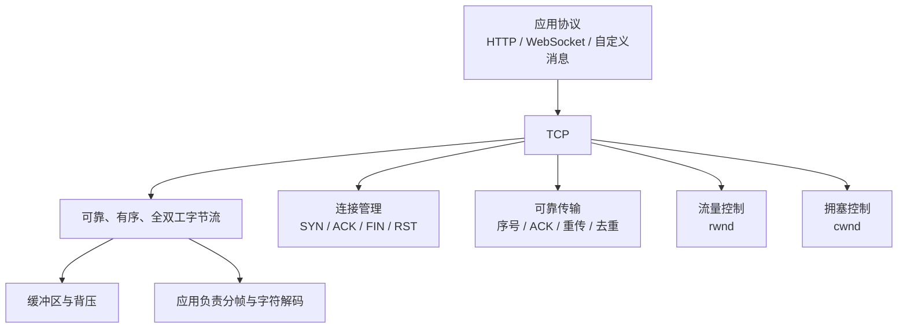

# TCP 核心知识

> 一句话理解：TCP 在不可靠的 IP 网络之上，为应用提供“面向连接、可靠、有序、全双工”的字节流，并通过流量控制和拥塞控制决定发送节奏。

## 快速知识图



## 1. TCP 在解决什么问题

TCP 是传输层协议，位于 IP 之上、HTTP 等应用协议之下：

```text
应用协议：HTTP / WebSocket / 自定义消息协议
               ↓
传输协议：TCP
               ↓
网络协议：IP
```

IP 尽力投递数据包，但不保证不丢失、不重复、不乱序。TCP 使用序号、确认、重传和去重，把这些能力组合成一个连续的字节流。

TCP 的“可靠”有明确边界：

- 它能保证已正常交付的字节按序、无重复。
- 数据持续发不出去时，连接最终会失败。
- 它不保证业务处理成功，也不理解 JSON、聊天消息或文件内容。
- 它不保留应用一次 `write()` 或 `send()` 调用的消息边界。

因此：

```text
TCP 传到了
≠ 对端程序已经读取
≠ 对方已经解析出完整业务消息
≠ 业务已经处理成功
```

## 2. 连接、角色与四元组

主动发起连接的一方是客户端，监听端口并接受连接的一方是服务端。连接建立后，双方都能发送和接收数据，也都可以成为主动关闭方。

`accept()` 接受的是**连接**，不是一条业务消息：

- `ServerSocket` / `ServerSocketChannel` 负责监听端口。
- 每次 `accept()` 返回一个 `Socket` / `SocketChannel`。
- 每个返回的连接都有自己的输入、输出、序号、窗口和 TCP 状态。

一条 TCP 连接由四元组区分：

```text
源 IP + 源端口 + 目标 IP + 目标端口
```

例如，同一客户端连接同一服务端端口两次，本地源端口通常不同：

```text
192.168.1.10:51001 → 192.168.1.20:9091
192.168.1.10:51002 → 192.168.1.20:9091
```

### 三次握手

```text
客户端                         服务端
  SYN ------------------------->
      <---------------- SYN + ACK
  ACK ------------------------->
```

三次握手用于交换并确认初始序号和连接参数。第三次 ACK 让服务端确认自己的 SYN 已被客户端收到。

握手成功只说明双方已经建立可用的 TCP 连接，不说明业务登录成功，也不说明服务端线程已经开始处理业务请求。

`SYN` 是 Synchronize（同步），`ACK` 是 Acknowledgment（确认）。SYN 和 FIN 都会占用一个序号；下文的字节序号示例只计算应用数据。

## 3. 数据从程序到程序经过了什么

假设客户端向服务端发送数据：

```text
客户端程序 write()
→ 客户端 Java 缓冲层（若有）
→ 客户端操作系统 TCP 发送缓冲区
→ 网络
→ 服务端操作系统 TCP 接收缓冲区
→ 服务端程序 read(byte[])
→ 服务端业务解析
```

反方向也有相同的发送和接收结构。所谓“缓冲区”至少有两种不同层次：

1. Java 程序自己的数组、`ByteBuffer`、`BufferedReader` 等程序缓冲区。
2. 操作系统内核为每条 TCP 连接维护的发送缓冲区和接收缓冲区。

### 四个动作不能混为一谈

```text
write() 正常返回
≠ 对方 TCP 已收到
≠ 对方程序已 read()
≠ 对方已拼成完整消息
≠ 对方业务已处理成功
```

- `write()` 返回通常表示本机发送路径已接受这些字节。
- TCP ACK 表示接收端 TCP 已接收字节，不等待应用读取。
- `read()` 只读取当前可用的字节，不保证读到完整业务消息。
- 业务成功必须由对端应用明确返回处理结果。

## 4. 可靠传输：序号、ACK、乱序与重传

### 序号按字节编号

```text
字节： H    E    L    L    O
序号：100  101  102  103  104
```

累计 ACK 表示“这个序号之前的连续字节我都收到了”。

```text
ACK = 103
```

含义是已经连续收到 `102` 及之前的字节，下一个期望 `103`。它不是对“第 103 条业务消息”的确认。

### 缺口会阻塞后续字节交付

```text
发送内容：hello\nworld\njava

已连续收到：100～103   hell
缺少：      104～111   o\nworld\n
迟到收到：  112～115   java
```

接收端可以先把 `hell` 交给程序，但不能越过缺口直接交付 `java`。累计 ACK 仍指向缺失位置。

缺口补齐后，接收端才按序继续交付。这就是 TCP 在单条连接内部的字节流队头阻塞。

### 重传与去重

没有及时收到 ACK，不一定代表对方没有收到。可能的原因包括：

- 数据包丢失。
- ACK 丢失。
- 数据或 ACK 只是延迟。

发送方在确认前保留未确认数据，以便重传：

- **超时重传**：RTO 到期后重传。
- **快速重传**：经典 TCP 在收到 3 个重复 ACK 后，推测前方缺口未到，提前重传。

RTO = Retransmission Timeout，重传超时；它会根据往返时间及其波动动态调整。

重传不等于重连。TCP 继续使用原来的四元组和连接状态。接收端根据序号去重，不会把同一批字节重复交付给应用。

## 5. 流量控制与拥塞控制

TCP 不是收到数据就无限速发送。一个发送方向至少同时受到两个窗口限制：

| 名称 | 含义 | 谁维护 | 解决的问题 |
|---|---|---|---|
| `rwnd` | Receive Window，接收窗口 | 接收方通告 | 接收方缓冲区还能容纳多少数据 |
| `cwnd` | Congestion Window，拥塞窗口 | 发送方 TCP | 当前网络路径能承受多少未确认数据 |

简化公式：

```text
可发送的新数据
≈ max(0, min(rwnd, cwnd) - 当前未确认字节数)
```

例如：

```text
rwnd = 10,000
cwnd = 2,000
当前未确认 = 1,500

可再发送 = min(10,000, 2,000) - 1,500
         = 500 字节
```

“未确认”是发送方视角。数据可能仍在网络中，也可能对方已经收到、ACK 正在返回，或者数据/ACK 已丢失。ACK 到来前，它仍占用窗口额度。

### 滑动窗口

下面是窗口上限固定为 1,000 字节的累计 ACK 示例：

| 事件 | 新释放额度 | 可继续发送 |
|---|---:|---|
| 已发送 1000～1999 | 0 | 无 |
| 收到 ACK 1400 | 400 | 2000～2399 |
| 发出 2000～2399 | 0 | 无 |
| 再次收到 ACK 1400 | 0 | 无 |
| 收到 ACK 1500 | 100 | 2400～2499 |

累计 ACK 向前推进多少，就确认并释放多少新额度。接收端可能使用延迟 ACK，因此不保证每个 TCP 段都立即得到单独确认。

### 零窗口与背压

接收程序读取太慢时：

```text
服务端程序不读取
→ 服务端 TCP 接收缓冲区逐渐填满
→ 服务端通告 rwnd = 0
→ 客户端 TCP 暂停普通新数据发送
→ 客户端程序继续 write()
→ 客户端发送缓冲区逐渐填满
→ 后续 write() 可能阻塞或无法立即写入
```

这属于背压，不代表网络已经断开。接收方腾出空间后会更新窗口；窗口更新报文可能丢失，因此零窗口期间发送方会用探测机制确认新的可用空间。

### 拥塞控制

流量控制防止压垮接收方，拥塞控制防止压垮中间网络。

经典 Reno 的简化过程：

1. **慢启动**：`cwnd` 从较小值开始，快速增长。
2. **拥塞避免**：达到慢启动阈值 `ssthresh` 后，增长变慢。
3. **重复 ACK**：快速重传并进入快速恢复。
4. **超时重传**：把 `cwnd` 降到更小，再重新试探。

现代内核可能使用 CUBIC、BBR 等算法，具体实现因系统而异。丢包可能意味着拥塞，也可能来自链路错误；降低发送速度是经典 TCP 对网络压力的保守响应。

MSS = Maximum Segment Size，单个 TCP 报文段能够承载的数据大小上限。慢启动和拥塞避免中常以 MSS 描述窗口增长量。

## 6. TCP 是字节流，不会替你分消息

TCP 只保证连续字节的顺序和可靠性，不知道 `HELLO` 是一条消息还是几条消息的一部分。

### 半包与粘包

```text
应用想发送两条换行分隔的消息：
HELLO\nWORLD\n

第一次 read：HEL
第二次 read：LO\nW
第三次 read：ORLD\n
```

接收程序需要自己累积并寻找消息边界：

```text
HEL + LO\nW
→ HELLO\n + W

W + ORLD\n
→ WORLD\n
```

“粘包”不是 TCP 把两条业务消息真的粘成一条，而是应用数据没有与应用 `read()` 调用一一对应。

常见分帧方式：

- 行分隔：以 `\n` 结束，但内容本身不能随意包含未转义的换行。
- 长度前缀：先读固定长度字段，再读指定字节数。
- 固定长度：每条消息长度固定。
- 协议自带边界：例如 HTTP 的 `Content-Length` 或分块编码。

### 字节数不等于字符数

`read(byte[])` 返回 `3`，只代表读到了 3 个字节，不代表 3 个字符。UTF-8 中一个汉字通常占 3 字节，而且一个字符可能跨两次读取。

```text
第一次读取：[E4 BD]
第二次读取：[A0]
```

必须使用能保留解码状态的 `InputStreamReader` 或自行实现增量 UTF-8 解码，不能对每次读取的字节分别 `new String(...)` 后直接拼接。

## 7. 连接关闭：FIN、TIME_WAIT 与 RST

TCP 是全双工协议，两个发送方向要分别结束。FIN 表示“我不再发送新数据”，但对方仍可以继续发送。

正常挥手通常表现为：

```text
主动关闭方                        被动关闭方
  FIN ----------------------------> 我不再发送
      <------------------------ ACK
      <--------- 剩余数据仍可发送 ----
      <------------------------ FIN
  ACK ---------------------------->
```

对方的 ACK 和 FIN 可以合并，因此实际报文数量不一定固定为四次。

收到 FIN 并读完此前数据后，`read()` 返回 `-1`。这只说明对方发送方向结束，不证明本方也必须立刻关闭。

### TIME_WAIT

主动关闭方发出最后一个 ACK 后，通常进入 `TIME_WAIT`：

- 如果最后 ACK 丢失，对方会重传 FIN，本方可再次确认。
- 保存旧连接状态一段时间，可以让迟到报文自然消失。
- 通常等待 `2MSL`，具体值由系统实现决定。

`TIME_WAIT` 不是在等待“ACK 的 ACK”。正常的最后 ACK 发出后，不需要再收到消息，只需等待状态超时。

MSL = Maximum Segment Lifetime，报文段在网络中的最大估计生存时间；`TIME_WAIT` 通常持续 `2MSL`，具体由系统实现决定。

### FIN 与 RST

| 信号 | 含义 | 应用层常见表现 |
|---|---|---|
| FIN | 正常结束一个发送方向，已有数据尽量交付 | 读完剩余数据后 `read()` 返回 `-1` |
| RST | 直接中止连接 | 读写时可能抛出 `Connection reset` 等异常 |

RST 不按正常四次挥手完成，可能来自无监听端口、协议错误或主动中止连接。

## 8. TCP 与 BIO、NIO 的关系

TCP 是传输层协议；BIO 和 NIO 是应用使用操作系统 I/O 能力的两种编程模型。

| 问题 | TCP 提供的能力 | 应用仍需处理 |
|---|---|---|
| 数据是否可靠、有序 | 序号、ACK、重传、去重 | 异常、超时和业务失败 |
| 能发送多少 | `rwnd`、`cwnd` | 背压、队列和慢客户端 |
| 消息在哪里结束 | 无业务边界 | 分帧和字符解码 |
| 谁等待 I/O | 缓冲区与连接状态 | BIO 阻塞线程或 NIO 轮询就绪事件 |
| 连接何时结束 | FIN / RST 与状态机 | 半关闭、清理资源和重连策略 |

## 9. 高频误区

| 说法 | 正确理解 |
|---|---|
| TCP 可靠，所以业务一定成功 | TCP 只保证传输层正常交付，业务仍需确认 |
| TCP 有消息边界 | TCP 只有连续字节流 |
| 一次 `read()` 就是一条消息 | 一次读取可能是半条、几条或一条加下一部分 |
| 没收到 ACK，就表示对方没收到 | 也可能是 ACK 丢失或延迟 |
| `rwnd` 和 `cwnd` 是上下行 | 它们共同限制同一个发送方向 |
| 发生丢包后补发即可 | 经典拥塞控制还要降低发送速度，减轻网络压力 |
| FIN 表示连接立刻完全关闭 | FIN 只结束一个发送方向，另一方向可能仍在发送 |
| TIME_WAIT 会阻塞 Java 线程 | 通常是内核状态，不要求应用线程持续等待 |

## 10. 自测

1. TCP、BIO、HTTP 分别属于什么层或模型？
2. `accept()` 获得的是什么？它是否等于一条消息？
3. 为什么 `write()` 成功不能证明业务处理成功？
4. TCP ACK 与完整业务消息之间是什么关系？
5. 为什么前序字节缺失时，后面的字节不能立即交给应用？
6. `rwnd` 和 `cwnd` 分别由谁维护，分别解决什么问题？
7. 接收程序读取慢时，背压如何从接收缓冲区传到发送程序？
8. TCP 为什么需要应用层分帧？
9. FIN 与 RST 有什么区别？
10. 为什么主动关闭方发完最后 ACK 后还要等待 `TIME_WAIT`？

## 11. 标准答案

1. **TCP** 位于传输层，提供面向连接、可靠、有序、全双工的字节流；**BIO** 是一种阻塞 I/O 编程模型；**HTTP** 是应用层协议。
2. `accept()` 获得的是一个已经建立的 TCP 连接。连接中可以传输很多业务消息，因此它不等于一条消息。
3. `write()` 正常返回通常只表示本机发送路径接受了这些字节；对端是否收到、应用是否读取、业务是否成功都需要后续机制确认，业务成功应由应用层响应确认。
4. TCP ACK 按字节序号确认“连续收到了哪些字节”，与业务消息边界无关。一个 ACK 可能覆盖多次 `write()`，也可能只确认半条消息。
5. TCP 必须把字节按序交给应用。前序字节缺失时，后面已经到达的字节只能暂存，不能越过缺口交付，否则应用会看到乱序或缺失的字节流。
6. `rwnd` 是接收方通告的接收窗口，用来保护接收缓冲区；`cwnd` 是发送方维护的拥塞窗口，用来控制进入网络但尚未确认的数据量。
7. 接收程序读取慢会使内核接收缓冲区逐渐填满，接收方通告零窗口，发送方 TCP 暂停普通新数据；发送程序继续写入后，本机发送缓冲区也会变满，最终形成写阻塞或背压。
8. TCP 只提供连续字节流，不保留一次 `write()` 的边界。一次应用写入可能被拆分，多次应用写入也可能被合并，所以必须用长度字段、分隔符等方式分帧。
9. FIN 是正常结束一个发送方向，已经发送的数据仍可继续读取；RST 是重置或中止连接，不走正常挥手流程，应用可能收到连接重置异常。
10. `TIME_WAIT` 用于重新确认可能重传的 FIN，并让旧报文有时间从网络中消失。最后一个 ACK 的发送方无法知道 ACK 是否到达，因此需要暂时保留连接状态。

