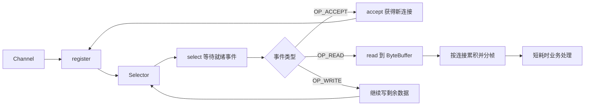

# NIO 核心知识

> 一句话理解：NIO 用少量线程等待一批连接上的“可接受、可读、可写”事件，使线程不必为每条空闲连接单独阻塞。

## 快速知识图



## 1. NIO 真正解决的问题

BIO 中，一个线程常常阻塞在某个连接上：

```text
线程 A → 等待客户端 A 的 read()
线程 B → 等待客户端 B 的 read()
线程 C → 等待客户端 C 的 read()
```

如果连接很多但多数时间没有数据，大量线程都在等待。

NIO 把等待方式改为：

```text
一个线程
→ 向 Selector 询问“哪些连接已经就绪”
→ 只处理真正有事件的连接
→ 处理完后继续等待下一批事件
```

NIO 的优势不是“所有操作都完全不阻塞”，而是应用线程不必为每条空闲连接各驻留一个阻塞读取线程。

## 2. 三个核心对象

| 对象 | 作用 | 可以把它理解成 |
|---|---|---|
| `Channel` | 连接网络或文件的通道，可读可写 | 一条连接或一个设备 |
| `Buffer` | 暂存待写或刚读出的字节 | 程序搬运数据的容器 |
| `Selector` | 等待并报告多个 Channel 的就绪事件 | 统一的事件登记与通知中心 |
| `SelectionKey` | Channel 与 Selector 之间的登记记录 | “这条 Channel 关注哪些事件” |

一个 Channel 注册到 Selector 后会得到 `SelectionKey`：

```text
Channel + Selector + 关注事件 → SelectionKey
```

常见事件：

```java
SelectionKey.OP_ACCEPT   // 有连接可以接受
SelectionKey.OP_CONNECT  // 主动连接已经就绪
SelectionKey.OP_READ     // 有数据可读，或连接已结束
SelectionKey.OP_WRITE    // 发送缓冲区有空间，可以继续写
```

## 3. 服务端启动流程

```text
1. ServerSocketChannel.open()
2. 绑定监听端口
3. configureBlocking(false)
4. Selector.open()
5. serverChannel.register(selector, OP_ACCEPT)
6. while (true) {
       selector.select()
       遍历 selectedKeys()
       按事件类型处理
       clear()
   }
```

可以写成：

```java
ServerSocketChannel server = ServerSocketChannel.open();
server.bind(new InetSocketAddress(9092));
server.configureBlocking(false);

Selector selector = Selector.open();
server.register(selector, SelectionKey.OP_ACCEPT);

while (true) {
    selector.select();

    Iterator<SelectionKey> iterator = selector.selectedKeys().iterator();
    while (iterator.hasNext()) {
        SelectionKey key = iterator.next();

        if (key.isAcceptable()) {
            accept(server, selector);
        } else if (key.isReadable()) {
            read(key);
        } else if (key.isWritable()) {
            write(key);
        }

        iterator.remove();
    }
}
```

`selectedKeys()` 表示本次 Selector 报告的就绪项。遍历时移除已经处理的 key，避免下一轮重复处理旧事件。

`Selector.select()` 在没有就绪事件时会等待；有事件、被唤醒或到达超时时间后返回。它返回的是就绪事件数量，不是业务消息数量。

从集合中移除一个 `SelectionKey`，只表示“本轮事件已经处理过”；要让 Channel 不再被 Selector 关注，需要调用 `key.cancel()` 或关闭 Channel。

## 4. 接受连接：OP_ACCEPT

`OP_ACCEPT` 表示监听信道有新连接可以接受：

```java
if (key.isAcceptable()) {
    ServerSocketChannel server =
            (ServerSocketChannel) key.channel();

    SocketChannel client = server.accept();
    if (client == null) {
        continue;
    }

    client.configureBlocking(false);
    client.register(selector, SelectionKey.OP_READ);
}
```

要区分两个 Channel：

- `ServerSocketChannel`：只在服务端存在，用于监听和接受连接。
- `SocketChannel`：每个客户端连接一个，用于双向读写。

Selector 只报告“可以 accept”，不会代替程序调用 `accept()`。

## 5. 读取：OP_READ

`OP_READ` 表示 Channel 可以尝试读取，但不代表一定有一条完整消息。

非阻塞 `SocketChannel.read(buffer)` 的返回语义：

| 返回值 | 含义 |
|---|---|
| `> 0` | 本次读到了若干字节 |
| `0` | 当前没有数据，通常继续等待下一次就绪 |
| `-1` | 对端结束发送，连接读取方向关闭 |

```java
int n = client.read(buffer);

if (n == -1) {
    key.cancel();
    client.close();
} else if (n > 0) {
    // 处理本次读到的字节
}
```

`read()` 返回 `-1` 只表示对端不再发送新数据，本方在连接完全关闭前仍可以继续写出响应。

### 不能假设一次 read() 得到完整消息

TCP 是字节流：

```text
发送方：hello\nworld\n
第一次 read：hel
第二次 read：lo\nwor
第三次 read：ld\n
```

应用必须自己累积：

```text
旧累积 + 本次读取
→ 寻找 \n 或长度字段
→ 提取完整消息
→ 保留未完成末尾
```

一个常见结构是给每个 Channel 保存独立的累积缓冲区：

```text
SelectionKey / Channel
└── ByteBuffer pending
    ├── 尚未组成完整消息的字节
    └── 下一次读取继续追加
```

每条连接都有自己独立的半包状态，不能由一个线程共用一个待处理数组。

可以把连接状态挂到 `SelectionKey` 上：

```java
key.attach(new ClientState());

ClientState state = (ClientState) key.attachment();
```

`ClientState` 通常包含该连接自己的累积缓冲区、待写队列、协议解析进度和关闭状态。

### ByteBuffer 的 capacity、position、limit

| 参数 | 含义 |
|---|---|
| `capacity` | Buffer 的总容量 |
| `position` | 下一次读取或写入的位置 |
| `limit` | 当前允许读写的边界 |

### ByteBuffer 的 flip() 与 compact()

写模式与读模式的 position/limit 不同：

```java
// 往 Buffer 写，或从 Channel 读进 Buffer
buffer.clear();
channel.read(buffer);

// 切换为读取 Buffer 中的数据
buffer.flip();

while (buffer.hasRemaining()) {
    // 读取字节
}

// 丢弃已处理数据，保留未处理数据，准备下次写入
buffer.compact();
```

处理完整消息后，如果末尾还有半条消息，不能直接 `clear()` 覆盖，而应使用 `compact()` 保留剩余字节。

`clear()` 只是重置 position 和 limit，让 Buffer 进入可写入状态，不会真正把底层内存清零。

### 本次对象传输实验：EOF 作为请求结束

当前实验采用“一条连接发送一个对象”的简化协议：

```text
客户端序列化对象并发送
→ 客户端 shutdownOutput()，结束自己的发送方向
→ 服务端累计字节，读到 read() == -1
→ 服务端反序列化对象
→ 服务端写出 UTF-8 响应
→ 响应全部交给本机发送路径后关闭连接
```

这里把 EOF 当作请求结束标记。它适合一次请求一条连接，但不适合在同一条长连接中反复发送对象。

若要在长连接中连续传输对象，需要改用长度字段、固定长度等明确的应用层分帧规则。

## 6. 写入：OP_WRITE 不是“我想写就注册”

主动发送数据时，直接调用：

```java
int written = client.write(byteBuffer);
```

返回值表示本次实际写入了多少字节，可能小于剩余数据量。

如果一次没有写完：

```text
剩余数据放入待写队列
→ interestOps 加上 OP_WRITE
→ Selector 在发送缓冲区有空间时通知
→ 继续写
→ 队列写空后移除 OP_WRITE
```

示意代码：

```java
ByteBuffer out = ...;

int n = client.write(out);
if (out.hasRemaining()) {
    pendingOutput = out;
    key.interestOps(key.interestOps() | SelectionKey.OP_WRITE);
}
```

可写事件中：

```java
client.write(pendingOutput);

if (!pendingOutput.hasRemaining()) {
    pendingOutput = null;
    key.interestOps(key.interestOps() & ~SelectionKey.OP_WRITE);
}
```

### 为什么不能一直关注 OP_WRITE

发送缓冲区大多数时间都有空间，如果一直关注 `OP_WRITE`，Selector 可能频繁报告可写，造成空转。

合理策略是：

```text
有未写完数据 → 才关注 OP_WRITE
待写数据清空 → 立即取消 OP_WRITE
```

`OP_WRITE` 表示“底层还能接受更多数据”，不表示“业务必须马上发送”。

### 写缓冲与背压

```text
业务不断产生消息
→ 应用写队列增长
→ 客户端网络慢，TCP 发送缓冲区逐渐满
→ write() 可能写 0 或只写一部分
→ 待写数据继续积压
```

如果无限缓存待写数据，会消耗越来越多内存。应用需要：

- 给每条连接的待写队列设置上限。
- 队列达到上限时停止读取该连接，形成背压。
- 设置超时，必要时断开长期不消费数据的客户端。
- 把业务处理与网络线程分开，避免慢业务拖住整个事件循环。

## 7. Selector 事件循环与线程模型

典型事件循环：

```text
select() 等待就绪
→ 取得 selectedKeys
→ 依次处理 accept/read/write
→ 清理 selectedKeys
→ 回到 select()
```

一个线程可以管理多条连接，但一次只能执行一个任务。如果某个 Handler 中查询数据库 3 秒，这个 Selector 线程中的其他连接也会等待。

因此：

- 网络事件处理应尽量短。
- 阻塞 I/O、数据库查询和远程 HTTP 调用应交给业务线程或其他异步机制。
- 多个 Selector 线程可以分担连接，但每条 Channel 的状态通常只由一个线程修改，减少并发冲突。

## 8. NIO 与 BIO 对比

| 维度 | BIO | NIO |
|---|---|---|
| 等待方式 | 线程阻塞在单个连接 | Selector 等待一组连接的就绪事件 |
| 连接数量大但空闲 | 通常需要许多等待线程 | 少量线程可以管理大量连接 |
| `read()` | 可能阻塞到有数据、结束或异常 | 非阻塞 Channel 当前没数据时返回 `0` |
| `write()` | 发送路径不足时可能阻塞 | 只写一部分，剩余数据后续继续写 |
| 半包处理 | 每连接通常一个线程可直接累积 | 应用仍必须按连接累积，并发状态更多 |
| 主要难点 | 线程数量和阻塞边界 | 事件状态、半包、续写、背压和线程安全 |

### 二进制位与 interestOps

某个事件通常是一个二进制位：

```text
OP_READ  = 0001
OP_WRITE = 0100
```

增加关注事件：

```java
interestOps = interestOps | OP_WRITE;
```

移除关注事件：

```java
interestOps = interestOps & ~OP_WRITE;
```

判断是否关注：

```java
boolean writeInterested =
        (interestOps & SelectionKey.OP_WRITE) != 0;
```

按位或用于“打开某个开关”，按位与配合取反用于“关闭某个开关”。

## 9. 常见错误

| 错误 | 后果 | 修正 |
|---|---|---|
| 仍用阻塞 Channel 注册 Selector | 注册时抛异常 | Channel 必须先设为非阻塞 |
| 一次 `read()` 就当完整消息 | 半包、截断、乱码 | 按连接累积并按协议分帧 |
| 把 `read()` 返回 `0` 当连接关闭 | 错误断开连接 | 只有 `-1` 表示读取方向结束 |
| 处理完 selected key 不清理 | 旧事件被反复处理 | `iterator.remove()` 或最后 `clear()` |
| 一直关注 `OP_WRITE` | Selector 空转、CPU 高 | 只有未写完时才注册 |
| 一次没写完就丢弃剩余 ByteBuffer | 数据被截断 | 保留 remaining 数据，后续续写 |
| 所有连接共用一个 pending 数组 | 不同客户端的字节混在一起 | 每条连接独立保存状态 |
| 在 Selector 线程执行慢业务 | 其他连接全部延迟 | 把阻塞任务移到业务线程池 |
| 无限缓存待写消息 | 内存持续增长 | 队列限流并形成背压 |
| 每个事件频繁修改 interestOps | 可读事件可能延迟 | 合并更新并保持状态清晰 |

## 10. 与 TCP、BIO、Netty 的关系

```text
TCP
→ 提供可靠有序的字节流、连接状态、窗口与背压

BIO
→ 用阻塞 read/write 直接使用 TCP 字节流

NIO
→ 用 Channel + Buffer + Selector 管理大量连接的就绪事件

Netty
→ 在 NIO 等传输之上封装 EventLoop、ChannelPipeline、编解码和资源管理
```

NIO 没有消除 TCP 的分帧问题、慢客户端问题和写缓冲问题。它改变的是等待 I/O 的方式，应用协议和状态管理仍需自己处理。

## 11. 自测

1. NIO 为什么能用少量线程管理大量连接？
2. `ServerSocketChannel` 与客户端连接得到的 `SocketChannel` 有什么区别？
3. `OP_ACCEPT` 就绪后，Selector 会自动执行 `accept()` 吗？
4. 非阻塞 `read()` 返回 `0` 和 `-1` 分别表示什么？
5. 为什么一次 `read()` 可能只读到半条消息？
6. `selectedKeys()` 为什么需要清理？
7. 一次 `write()` 没有写完时，剩余数据放在哪里？
8. 为什么不能一直关注 `OP_WRITE`？
9. `interestOps | OP_WRITE` 与 `interestOps & ~OP_WRITE` 分别做什么？
10. 在 Selector 线程中执行慢数据库查询会有什么后果？

## 12. 标准答案

1. NIO 把多条 Channel 注册到 Selector；线程通过 `select()` 等待就绪事件，只处理当前有事件的连接，因此空闲连接不需要各自占用一个阻塞线程。
2. `ServerSocketChannel` 通常只有一个，负责监听端口和接受连接；`SocketChannel` 每个客户端连接一个，负责该连接的读写。
3. 不会。Selector 只报告 `OP_ACCEPT` 就绪；程序仍要调用 `accept()` 来取得新的 `SocketChannel`。
4. `read()` 返回 `0` 表示当前没有可读数据，但连接仍然开放；返回 `-1` 表示对端已经结束发送方向。收到 `-1` 后，本方在完全关闭前仍可以写出响应。
5. TCP 是字节流，`read()` 返回的是当前可用字节数，可以少于一条完整消息。消息边界必须由应用协议和累积逻辑确定。
6. `selectedKeys()` 是本轮报告的就绪 Key 集合。不清理会让已经处理过的事件留在集合中，下一轮可能被重复处理。
7. 未写完的 `ByteBuffer` 要保存在该连接自己的待写队列中，并注册 `OP_WRITE`；收到可写事件后，从原 position 继续写。
8. Socket 通常长期处于可写状态。一直关注 `OP_WRITE` 会反复触发可写事件并造成空转，因此只在存在未写完数据时注册。
9. `interestOps | OP_WRITE` 打开写事件开关；`interestOps & ~OP_WRITE` 只关闭写事件开关，保留其他事件。
10. Selector 事件处理通常是串行的。一个线程被慢数据库查询阻塞时，同一个 Selector 管理的其他连接也无法及时处理，所以阻塞任务应交给业务线程或其他异步机制。

