# LBPM 学习笔记：新建、提交与后台执行

本次例子：KmReviewMain，开始 → 起草 → 一人审批 → 结束。
记录日期：2026-11-06。以下以本机 zj 项目已读代码和实际调试为依据。

## 1. 打开新建页面：已经创建流程实例

```text
KmReviewMainAction.createNewForm()
→ Service.initFormSetting()
→ 机制分发 initFormSetting()
→ LbpmProcessCoreServiceImp.initFormSetting()
→ LbpmAPIService.createInstance()
→ 查找流程定义 ProcessDefinition
→ processExecuteService.restart()
→ ProcessInstanceStarter.start()
   ├─ buildInstance()：创建 LbpmProcess，并调用 accessManager.save()
   └─ virtualMachineService.start()：驱动流程运行到起草节点等待
→ 初始化事务提交
```

- 流程定义描述规则；流程实例代表本张申请的运行；执行路径记录当前执行位置。
- buildInstance 中，流程实例 fdId、fdModelId 都使用业务表单的单据 ID；fdModelName 标明业务 Model 类型。
- save() 不等于当场提交事务；初始化 Service 的 init* 方法配置了 REQUIRED 事务。
- 本次实测：刷新新建页面会增加实例，关闭页面不会立即删除记录。是否存在后续清理任务尚未核实。
- 实例存在不等于已经提交审批；当前实例停在起草节点。

## 2. 点击提交：保存业务数据，并通过机制提交流程操作

```text
KmReviewMainAction.save()
├─ mainForm.setDocStatus("20")
└─ super.save()
   → Service.add(form, requestContext)
      ├─ Form → Model：LBPM 机制复制流程操作参数
      └─ add(model)
         ├─ DAO 保存 KmReviewMain
         └─ dispatchCoreService.add(model)
            → BaseCoreOuterServiceImp.add(model)
            → LbpmProcessCoreServiceImp.save(model)
            → lbpmService.approveProcess(model, processForm, true)
```

关键修正：LbpmProcessCoreServiceImp 没重写 add()，但父类 add() 调用 save(model)，子类重写了 save()。因此流程处理确实可以从 add 分发进入。

approveProcess 查找已有实例、校验操作参数、按条件更新流程状态，最后调用 updateByPanel()。业务 docStatus 与流程 fdStatus 是不同字段。

```text
updateByPanel()
→ 解析 fdParameterJson
→ 组装 OperationParameters：processId、operationType、activityType、taskId、具体参数
→ processExecuteService.execute()
→ ProcessInstanceExecutor.execute()
   ├─ prepareStatement()：操作准备，内部细节本轮未完整展开
   └─ saveToEventQueue()：创建并保存 LbpmQueue
```

暂存不应推动起草进入审批；本项目具体暂存参数仍需运行时确认。updateByPanel 有 canStartProcess=false 且无附加操作时直接返回的分支。

## 3. 数据库队列与提交后通知

LbpmQueue 保存流程任务信息，包括流程、任务、活动类型、序列化操作参数、操作人 ID 等。

```text
ProcessQueueService.add(task)
→ accessManager.save(task)
→ 登记事务提交事件回调
→ 事务提交成功
→ notifyWorker(task)
→ 根据 fdDistributeId 查目标服务器标识
→ MessageCenter.sendToServer(new WorkerRunMessage(serverKey), serverKey)
```

WorkerRunMessage 是“请开始调度”的通知，不是完整的审批操作数据。实际操作仍在数据库队列中。

重点设计分析：使用数据库持久化队列，优先保证可靠性和本地事务一致性。业务数据与队列记录可在同一本地事务中提交。高吞吐、跨服务场景可引入 MQ，但仍要解决重复消费、同一流程操作顺序及事务一致性，不能直接用“发消息”替换 save(task)。这属于基于实现的设计分析。

事务回调实现：DefaultEventMulticaster 将回调包装后交给 TransactionEventListener；正常事务中存入 ThreadLocal 事务状态。HibernateTransactionManagerSupport 在 super.doCommit() 成功后调用 afterCommitTransaction()，再运行匹配的回调。没有事务状态时，相关实现可能直接运行回调。

## 4. 本机通知怎样被消费

```text
sendToServers()
├─ 目标含本机：sendLocalMessage()
└─ 其他目标：sendRemoteMessage()，远程传输细节未展开

本机 → MessageReceiveThread.addMessage()
       加锁 → queue.offer(message) → signalAll() → 解锁
```

消息中心启动时创建接收线程，线程名 ekp_cluster_message。父类 AbstractThread.run() 循环调用 doRun()。

- 队列为空时 await(timeout)：释放锁、等待、重新取得锁后返回，不重新执行开头的 lock()。
- signalAll() 只是发出唤醒信号，不会把锁立即交出去；生产者解锁后，消费者才能重新取得锁。
- 调试器暂停不等于 await 等待；断在 await 执行前，线程可能仍持锁。
- 消费循环：加锁 → poll() → 解锁 → runReceiver(message)，直到取到 null。
- 整体相当于事件循环；不是持锁执行接收器。

```text
runReceiver(message)
→ 查找匹配的 IMessageReceiver
→ 从 receiverRunnerMap 复用接收器对应的 ReceiverRunner
→ runner.excute(message)
   ├─ 空闲：设置 runningMessage，提交群集消息处理线程池
   └─ 忙碌：加入 receiver 自己的等待队列
→ 线程池调用 ReceiverRunner.run()
→ 开启事务
→ receiver.receiveMessage(runningMessage)
→ 成功提交／异常回滚
→ finally 取该接收器下一条消息，再提交线程池
```

复用 Runner 是为了维护同一接收器的运行中消息状态，按条安排消息处理。

三种队列不要混淆：数据库 LbpmQueue 保存流程操作；MessageReceiveThread.queue 保存通知；receiver 的 MessageQueue 保存该接收器等待处理的通知。后两者是内存队列。

## 5. 工作端调度真正的流程任务

```text
WorkerRunMessage 的接收器：在 FlowWorkerServer.start() 中注册
→ receiveMessage()
→ FlowWorkerServer.doProcessWithLock()
   检查流程线程池状态，tryLock 防止本工作端并发启动多轮调度
→ flowDriver.doProcess(this)
→ 实际实现 ProcessQueueDistributor
→ doCurrentTasks(worker)
→ getEarliestTasks(100, distributeId)
   按根流程分组，取最早任务，最多取 100 组
→ 检查 runningTasks，避免本机重复安排同一根流程
→ 提交流程任务线程池 TaskRunnable
→ TaskRunnable.run()
   ├─ 重新读取该根流程最早任务
   ├─ flowQueueLock.tryLock(queue)
   └─ queueService.doTask(queueId)
```

另有 default、transfer 等调度路径；本轮重点追当前工作端任务。调度锁、本机根流程运行检查和任务锁是不同层次。

```text
ProcessQueueService.doTask()
→ 读取 LbpmQueue
→ backgroundAuthService.switchUserById()：使用记录的操作人身份
→ TaskRunner.run()
   ├─ 反序列化 OperationParameters
   ├─ 加载业务单据
   ├─ internalProcessExecuteService.doExecute()
   └─ 正常返回后删除队列记录并 flush、clear
```

还原的是本次操作，不是重新创建实例，也不是重新发送浏览器请求。

## 6. 当前追到：把操作信号交给任务行为

```text
ProcessInstanceExecutor.doExecute()
→ 加载已有实例，准备 ExecutionParameters
→ virtualMachineService.execute(operParameters, exeParams)
→ 取得 ExecutionWraper
→ wraper.signal(操作类型, 操作参数)
→ 有当前任务时，performAtomicOperation(new Signal(...))
→ 引擎操作调度调用 Signal.propagate(execution)
→ fire(new ActivateTaskEvent(), 当前任务, new SignalTask())
→ 监听正常处理完成后执行 SignalTask.propagate()
→ behaviour = execution.getBehaviour()
→ behaviour.signal(execution, signalName, parameters)
→ 若 execution.isEnded()
   ├─ abandonChildren()
   └─ performAtomicOperation("TransitionEndTask")
```

- 此处 signal() 是普通 Java 操作分派，不是 Condition.signalAll()。
- ActivateTaskEvent 表示任务被激活，不表示审批通过。节点与工作项分别有对应的上层激活事件。
- 同一任务可多次激活；不能把所有引擎路径都说成经过当前 Signal 操作。
- 当前暂停点：需要确认 behaviour 的运行时类型，再读它怎样处理 drafter_submit。尚未完整追到起草结束、审批节点选人和工作项创建。

## 7. fire 与流程事件

```java
fire(new ProcessStartEvent(), null, new TransitionStartProcess());
```

含义：触发事件，准备事件环境，执行监听通知；正常完成后继续后续操作。不是无条件 finally，异常或事件中断可能阻止或改变后续动作。

```text
fire()
→ 保存事件、来源、后续操作到 EventEnvironment
→ 安排 ExecuteEventListener
→ eventMulticaster.notify(execution, element)
→ 通知匹配监听器
→ 正常完成后执行保存的后续操作
```

这是引擎主动调用，不是 Spring AOP 自动产生的节点事件。这里的事件广播器与前面的事务事件广播体系应分清。

## 8. 机制、代理和插件配置补充

- BaseCoreOuterServiceImp 是机制服务基础类；KmReviewMain 是业务 Model；KmReviewMainForm 接收页面数据。
- 分发器启动刷新事件后按 ICoreOuterService 类型收集 Bean。IBaseCoreOuterService 定义通用操作；ICoreOuterService 标记常驻机制，IAdditionalService 用于临时服务。
- 分发列表使用 ThreadLocal 副本，允许当前线程增删临时机制；复制列表不复制服务对象。清理调用位置尚未完整追查。
- isAddAllowed 默认 true；业务 Service 实现控制接口且机制名称非空时才进一步询问，false 才跳过。
- 各机制内部还能用 Model 接口判断是否适用。强转不改变对象，instanceof 检查实际对象是否具备接口能力。
- @Component 或普通 XML bean 只负责注册，不天然生成代理。KmssBaseCoreService 父 Bean 定义 TransactionProxyFactoryBean，继承其配置并指定 target 后得到事务代理。
- 项目实测 custom/spring.xml 已加载，加入限定包的 component-scan 后，可发现自定义机制。配置文件的完整目录筛选规则尚未查实，不再假定任意目录都自动加载。
- extension-point 定义入口、item 和 param 规则；extension 按相同 point ID 提供配置；system/load 可指定加载处理器。无 system 时，业务代码可通过 Plugin.getExtensionPoint() 主动读取。
- JSP 扩展示例：LbpmProcessJspExtLoader 读取 jsp 参数存入 Manager；process_ext.jsp 调 getJspExts(modelName)，再用 c:import 引入路径。
- 本次 JSP 故障：配置 /custom/test.jsp，但文件位于 /WEB-INF/KmssConfig/custom/test.jsp，日志提示文件未找到。服务器内部引入可使用 WEB-INF 路径。
- plugin.xsd 要求 extension-point 在 extension 前；custom/plugin.xml 引用上一级 Schema 的相对路径是 ../plugin.xsd。

## 下一步

在 SignalTask 中观察 behaviour 的真实类，以及 signalName、taskId、activityType；以本次 drafter_submit 为线索，继续追具体行为 → 工作项结束 → 起草节点结束 → 路由 → 审批节点进入与工作项创建。每次只推进一段。

---

## 9. 扩展点与流程事件：从定义到执行

### 9.1 先区分三种“扩展”

| 名称 | 如何接入 | 谁调用 | 本次例子 |
|---|---|---|---|
| 机制分发 | 实现 ICoreOuterService，注册 Spring Bean | DispatchCoreServiceImp 遍历调用 | 保存单据时处理锁版本、流程参数 |
| 插件扩展点 | extension-point 定规则，extension 提供配置 | Loader 或主动读取配置的业务代码 | JSP 页面扩展、欢迎语扩展 |
| 流程事件监听 | 在 LBPM 事件扩展点下注册 listener | 流程运行时，事件广播器通知 | enterNodeEvent 节点进入监听 |

流程事件监听使用了插件扩展点来注册配置，但插件扩展点不全是事件。Spring AOP 则是方法调用拦截机制，也不等于以上任意一种。

### 9.2 为什么 point、item、param 这些字符串有意义

平台在 `WEB-INF/KmssConfig/sys/lbpm/engine/plugin.xml` 定义：

```xml
<extension-point id="com.landray.kmss.lbpm.engine.event">
    <!-- event：事件类型定义的规则 -->
    <!-- listener：监听器定义的规则 -->
    <system>
        <event name="load"
               class="com.landray.kmss.sys.lbpm.engine.manager.event.EventPluginLoader"/>
    </system>
</extension-point>
```

这是结构摘要，不是可直接复制的完整定义。这个 ID 是平台约定的唯一标识；模块通过相同 point ID 提供配置。它并非凭英文名称自动具有流程功能。

```text
extension-point：定义入口及允许的 item、param
        ↓ 相同 ID
extension：模块提供具体配置
        ↓
EventPluginLoader：解释并注册事件、监听器等配置
```

`item name="listener"` 的规则中，listener 参数声明为 `kind="spring"`，并要求对应对象符合 IEventListener。它表示 Spring Bean 名称，不是 Java 类名。

### 9.3 为什么 enterNodeEvent 对应节点进入

平台另有真实的事件类型注册：

```xml
<item name="event">
    <param name="type" value="enterNodeEvent"/>
    <param name="messageKey"
           value="sys-lbpm-engine:lbpm.eventType.enterNodeEvent"/>
    <param name="provider"
           value="com.landray.kmss.sys.lbpm.engine.manager.event.NodeEventProvider"/>
    <param name="monitors"
           value="com.landray.kmss.sys.lbpm.pvm.event.EnterTaskEvent"/>
</item>
```

NodeEventProvider 的实际适用判断：

```java
public boolean supports(ObservableElement element, String modelName) {
    return element instanceof NodeDefinition;
}
```

因此是“Java 事件类型 + 适用元素范围”的映射，不是看到字符串就猜含义：

```text
EnterTaskEvent，事件所在元素为 NodeDefinition
    → 匹配 enterNodeEvent
    → 找到 eventTypes 包含 enterNodeEvent 的监听配置
    → 调用配置中的监听器 Bean
```

### 9.4 写一个最小节点进入监听器

```java
package com.landray.kmss.custom;

import com.landray.kmss.sys.lbpm.engine.manager.event.EventExecutionContext;
import com.landray.kmss.sys.lbpm.engine.manager.event.IEventListener;
import org.springframework.stereotype.Component;

@Component("practiceNodeEnterListener")
public class PracticeNodeEnterListener implements IEventListener {
    @Override
    public void handleEvent(EventExecutionContext context, String parameter)
            throws Exception {
        System.out.println("[节点进入] 单据ID="
                + context.getMainModel().getFdId());
    }
}
```

前提：custom 包已经配置组件扫描。在已加载的 plugin.xml 中绑定：

```xml
<extension point="com.landray.kmss.lbpm.engine.event"
           model="com.landray.kmss.km.review.model.KmReviewMain">
    <item name="listener">
        <param name="unid" value="practiceNodeEnterListener"/>
        <param name="messageKey" value=""/>
        <param name="eventTypes" value="enterNodeEvent"/>
        <param name="listener" value="practiceNodeEnterListener"/>
        <param name="enforce" value="true"/>
    </item>
</extension>
```

- unid：扩展唯一标识；listener：实际 Spring Bean 名，两个值可以相同但角色不同。
- model：限制业务范围为 KmReviewMain。
- enforce=true：无需在节点属性中再勾选；仍需满足业务、事件等适用条件。
- enforce=false：需要在相应节点配置监听器。
- 这是监听既有事件，没有创建新的节点类型，也没有定义新的事件类型。

### 9.5 引擎在哪里触发，怎样通知

启动链中的真实例子：

```java
// ExecutionWraper.start()
fire(new ProcessStartEvent(), null, new TransitionStartProcess());
```

三个参数分别是事件、来源任务、事件正常完成后的操作。fire 是触发事件；propagate 是操作传播入口，均为引擎显式调用的方法。

```text
fire()
→ getListener() 准备 EventEnvironment
   保存事件、来源、后续操作
→ performAtomicOperation() 调度 ExecuteEventListener
→ ExecuteEventListener.propagate()
→ getEventMulticaster().notify(execution, element)
→ 匹配并执行事件监听器
→ 正常完成后取得 eventCompletedOperation
→ performAtomicOperation(后续操作)
```

具体广播器内部完整匹配链尚未逐层展开；以上已确认通知入口及配置映射，不能把未读的内部实现当成完整调用栈。

本次后续操作为 TransitionStartProcess，它定位起始节点并调用：

```java
scopedExecution.fire(new EnterTaskEvent(),
        scopedExecution.getTask(), "ExecuteTask");
```

这才触发开始节点进入事件。后续审批节点的进入由节点迁移路径触发，不能说每次进入审批都重新执行 TransitionStartProcess。

提交链中还有另一种事件：

```java
// Signal.propagate()
execution.fire(new ActivateTaskEvent(), execution.getTask(), new SignalTask(null));
```

它通知“当前任务被激活”，之后 SignalTask 调用 behaviour.signal()。激活不是通过，具体操作仍由 signalName 和参数决定。同一任务可多次激活。

### 9.6 三类事件不要混淆

| 事件 | 所属层次 | 用途 |
|---|---|---|
| plugin.xml 的 system/event name="load" | 插件配置加载 | 执行扩展点加载处理器 |
| EventOfTransactionCommit | 事务回调体系 | 数据库提交成功后通知工作端 |
| ProcessStartEvent、EnterTaskEvent、ActivateTaskEvent | PVM 流程执行 | 在流程生命周期位置执行监听扩展 |

PVM 是流程执行底层。VirtualMachineServiceImpl 是 Java 类，不是 JVM；它组织流程运行。事件通知是执行代码主动触发，不是靠一个线程持续监控节点，也不是因为 Service 有 AOP 代理就自动出现。

## 10. 总流程图：从打开页面到本次提交操作执行

实线为本轮已读调用或已确认的正常阶段关系；虚线为业务目标及后续待继续逐层验证的路径。通知的远程传输分支本轮未展开。

```mermaid
flowchart TD
    subgraph INIT[一：打开新建申请页面]
        A[KmReviewMainAction.createNewForm] --> B[Service.initFormSetting]
        B --> C[机制分发 initFormSetting]
        C --> D[LbpmProcessCoreServiceImp.initFormSetting]
        D --> E[LbpmAPIService.createInstance：取得流程定义]
        E --> F[processExecuteService.restart]
        F --> G[ProcessInstanceStarter.start]
        G --> H[buildInstance：创建 LbpmProcess 并 save]
        H --> I[实例 ID 与业务单据 ID 关联]
        I --> J[virtualMachineService.start]
        J --> K[ExecutionWraper.start]
        K --> L[fire：ProcessStartEvent]
        L --> M[事件监听处理正常完成]
        M --> N[TransitionStartProcess：定位起始节点]
        N --> O[fire：EnterTaskEvent，随后 ExecuteTask]
        O --> P[按流程运行到起草节点等待]
        P --> Q[初始化事务提交，展示新建页面]
    end

    subgraph SUBMIT[二：HTTP 请求线程提交申请]
        Q --> R[用户点击提交]
        R --> S[KmReviewMainAction.save：docStatus=20]
        S --> T[super.save → Service.add Form]
        T --> U[Form 转 Model：机制复制流程参数]
        U --> V[DAO 保存 KmReviewMain]
        V --> W[dispatchCoreService.add]
        W --> X[父类 add 调用 LBPM 子类 save]
        X --> Y[approveProcess：查实例、校验、更新状态]
        Y --> Z[updateByPanel：解析操作 JSON]
        Z --> AA[ProcessInstanceExecutor.execute]
        AA --> AB[prepareStatement：操作准备]
        AB --> AC[ProcessQueueService.add：保存 LbpmQueue]
        AC --> AD[登记事务提交回调]
        AD --> AE[事务提交成功]
        AE --> AF[notifyWorker：查目标工作服务器]
        AF --> AG[发送 WorkerRunMessage 通知]
    end

    subgraph MSG[三：通知接收与分派]
        AG --> AH{目标是否本机}
        AH -->|本机| AI[sendLocalMessage → addMessage]
        AH -->|其他服务器| AJ[sendRemoteMessage：本轮未展开]
        AI --> AK[加锁 → offer 内存消息队列 → signalAll → 解锁]
        AK --> AL[ekp_cluster_message 接收线程]
        AL --> AM[doRun：await 等待或唤醒，poll 取消息]
        AM --> AN[runReceiver：查匹配 receiver]
        AN --> AO[取得或创建缓存的 ReceiverRunner]
        AO --> AP{接收器是否空闲}
        AP -->|忙| AQ[进入接收器自己的等待队列]
        AP -->|空闲| AR[提交群集消息处理线程池]
        AQ -->|前一条结束后再提交| AR
        AR --> AS[ReceiverRunner.run：开启事务]
        AS --> AT[receiver.receiveMessage WorkerRunMessage]
    end

    subgraph SCHED[四：工作端调度数据库任务]
        AT --> AU[FlowWorkerServer.doProcessWithLock]
        AU --> AV[检查线程池，取得调度锁]
        AV --> AW[ProcessQueueDistributor.doProcess]
        AW --> AX[doCurrentTasks：查当前工作端任务]
        AX --> AY[按根流程分组取最早任务，最多 100 组]
        AY --> AZ[跳过本机已在运行的根流程]
        AZ --> BA[提交流程任务线程池 TaskRunnable]
        BA --> BB[重新读取根流程最早任务]
        BB --> BC[取得 flowQueueLock 任务锁]
        BC --> BD[ProcessQueueService.doTask]
        BD --> BE[按队列记录切换操作人身份]
        BE --> BF[TaskRunner：还原操作参数，加载业务单据]
    end

    subgraph EXEC[五：实际执行操作]
        BF --> BG[ProcessInstanceExecutor.doExecute]
        BG --> BH[加载已有实例，准备 ExecutionParameters]
        BH --> BI[VirtualMachineServiceImpl.execute]
        BI --> BJ[取得 ExecutionWraper]
        BJ --> BK[wraper.signal 操作类型与参数]
        BK --> BL[performAtomicOperation：Signal]
        BL --> BM[Signal.propagate]
        BM --> BN[fire：ActivateTaskEvent]
        BN --> BO[事件监听正常完成后执行 SignalTask]
        BO --> BP[取得当前任务 behaviour]
        BP --> BQ[behaviour.signal：处理具体提交操作]
        BQ --> BR{execution.isEnded}
        BR -->|否| BS[本次不执行任务结束迁移]
        BR -->|是| BT[abandonChildren → TransitionEndTask]
        BT -. 待继续逐层验证 .-> BU[起草完成，按路由进入审批]
        BU -. 待继续逐层验证 .-> BV[解析审批人，创建审批工作项并等待]
        BG -->|操作正常返回后| BW[lastHandle：同步标题、状态、处理时间]
        BW --> BX[TaskRunner 删除已处理队列记录]
    end
```



图中“操作正常返回”是方法返回后的收尾顺序，不表示与节点处理并行执行。图覆盖正常主线；异常回滚、重试和远程通知不是本轮完整展开的范围。

## 11. 连续文字流程：对应截图，补全至当前断点

```text
一、打开新建申请页面
│
├─ KmReviewMainAction.createNewForm()
│   └─ Service.initFormSetting()
│       └─ 分发到 LBPM 机制的 initFormSetting()
│           └─ LbpmAPIService.createInstance()
│               ├─ 取得流程定义：节点、连线等规则
│               └─ processExecuteService.restart()
│                   └─ ProcessInstanceStarter.start()
│                       ├─ buildInstance()
│                       │   └─ 创建并保存 LbpmProcess
│                       │      实例 ID = 当前表单的单据 ID
│                       └─ virtualMachineService.start()
│                           └─ ExecutionWraper.start()
│                               ├─ fire(ProcessStartEvent)
│                               └─ 正常处理监听后执行 TransitionStartProcess
│                                   ├─ 定位起始节点
│                                   └─ fire(EnterTaskEvent)，再执行 ExecuteTask
│                                       └─ 后续运行到起草节点等待
│
└─ 初始化事务提交，页面打开
   此时实例已存在，停在起草，等待操作


二、你填写申请，点击“提交”
│
├─ KmReviewMainAction.save()
│   ├─ 设置业务状态 docStatus = "20"
│   └─ super.save()
│       └─ 业务 Service.add(form, requestContext)
│           ├─ Form → Model
│           │   └─ LBPM 机制复制流程操作参数
│           └─ add(model)
│               ├─ DAO 保存 KmReviewMain
│               └─ dispatchCoreService.add(model)
│                   └─ LBPM 机制继承的 add()
│                       └─ 子类重写的 save()
│                           └─ approveProcess()
│                               ├─ 找到已有流程实例
│                               ├─ 检查操作参数、更新状态
│                               └─ updateByPanel()
│                                   ├─ 解析 operationType、taskId 等
│                                   └─ processExecuteService.execute()
│                                       └─ ProcessInstanceExecutor.execute()
│                                           ├─ prepareStatement()：准备操作
│                                           └─ saveToEventQueue()
│                                               └─ ProcessQueueService.add(task)
│                                                   ├─ 保存 LbpmQueue
│                                                   └─ 登记事务提交回调
│
└─ 当前事务提交成功
    └─ 回调 notifyWorker(task)
        ├─ 取得已分配的工作服务器标识
        └─ MessageCenter.sendToServer(WorkerRunMessage, serverKey)
            └─ sendToServers()
                ├─ 目标含本机 → sendLocalMessage()
                │   └─ MessageReceiveThread.addMessage()
                │       ├─ lock.lock()
                │       ├─ queue.offer(message)：通知消息入内存队列
                │       ├─ waitCondition.signalAll()：唤醒接收线程
                │       └─ lock.unlock()
                └─ 其他目标 → sendRemoteMessage()，远程路径未展开


三、本机消息接收线程处理通知
│
├─ 消息中心启动时创建 MessageReceiveThread 并 start()
│   └─ AbstractThread.run() 循环调用 doRun()
│
└─ MessageReceiveThread.doRun()
    ├─ 获取锁，检查队列
    ├─ 无消息且未到刷新时间 → await(timeout)
    │   ├─ 释放锁并等待
    │   └─ 被通知或超时后，重新取得锁，再从 await 返回
    ├─ finally 解锁
    ├─ 达到刷新间隔时，检查是否需要加载集群消息
    └─ 循环取通知
        ├─ 加锁 → queue.poll() → 解锁
        ├─ 无消息：doRun 返回，外层循环再次调用
        └─ 有消息：runReceiver(message)
            ├─ center.getReceivers(message)：匹配接收器
            ├─ receiverRunnerMap：取得或创建该 receiver 的 Runner
            └─ runner.excute(message)
                ├─ 忙：进入该接收器自己的等待队列
                └─ 空闲：runningMessage = message
                    └─ 提交群集消息处理线程池


四、群集消息处理线程池执行通知接收器
│
└─ ReceiverRunner.run()
    ├─ 开启事务
    ├─ receiver.receiveMessage(runningMessage)
    │   └─ 当前通知为 WorkerRunMessage
    │       └─ FlowWorkerServer 中注册的匿名接收器
    │           └─ doProcessWithLock()
    │               ├─ 检查流程线程池是否启动、是否忙碌
    │               ├─ lockDriveFlow.tryLock()：防止本工作端并发调度
    │               └─ flowDriver.doProcess(this)
    │                   └─ ProcessQueueDistributor.doProcess()
    │                       ├─ doCurrentTasks(worker) ← 本次重点路径
    │                       ├─ doDefaultTasks(worker)
    │                       ├─ doTransferTasks(worker)
    │                       └─ doCurrentTasks(worker)
    ├─ 接收器正常返回后提交事务；异常则回滚
    └─ finally：清空 runningMessage，取下一条等待通知再提交线程池


五、调度器读取数据库流程任务
│
└─ doCurrentTasks(worker)
    └─ distributeCurrentTasks(distributeId)
        ├─ 只读事务中 getEarliestTasks(100, distributeId)
        │   └─ 按根流程分组，每组最早一条，最多 100 组
        └─ distributeTasks(holders)
            ├─ containRootId()：本机已有该根流程任务则跳过
            └─ 流程任务线程池 submit(new TaskRunnable(holder))
                └─ TaskRunnable.run()
                    ├─ 再查该根流程的最早任务
                    ├─ flowQueueLock.tryLock(queue)
                    ├─ queueService.doTask(queueId)
                    └─ finally 释放任务锁


六、流程任务工作线程还原操作并执行
│
└─ ProcessQueueService.doTask(queueId)
    ├─ 读取 LbpmQueue
    └─ backgroundAuthService.switchUserById()
        └─ 按记录的操作人身份执行 TaskRunner.run()
            ├─ 反序列化队列参数，恢复 OperationParameters
            ├─ 加载业务单据
            ├─ internalProcessExecuteService.doExecute()
            │   └─ ProcessInstanceExecutor.doExecute()
            │       ├─ 加载已有 LbpmProcess
            │       ├─ 创建 ExecutionParameters
            │       ├─ virtualMachineService.execute()
            │       │   └─ VirtualMachineServiceImpl.execute()
            │       │       ├─ 取得 ExecutionWraper
            │       │       └─ wraper.signal(operationType, parameters)
            │       │           └─ 有当前任务时安排 new Signal(...)
            │       │               └─ 引擎调度调用 Signal.propagate()
            │       │                   └─ fire(ActivateTaskEvent, task, SignalTask)
            │       │                       └─ 监听正常完成后 SignalTask.propagate()
            │       │                           ├─ behaviour = execution.getBehaviour()
            │       │                           ├─ behaviour.signal(...) ← 当前重点
            │       │                           └─ 判断 execution.isEnded()
            │       │                               ├─ 否：不进入本次任务结束迁移
            │       │                               └─ 是：abandonChildren()
            │       │                                   → TransitionEndTask
            │       └─ 正常返回后 lastHandle(process)
            │           └─ 同步标题、业务状态、最后处理时间并保存
            └─ 操作正常返回后删除 LbpmQueue，并 flush、clear


七、下一段业务目标（尚未逐层追完，不能视为完整验证过的调用栈）
│
└─ 具体 behaviour 处理 drafter_submit
    → 起草工作项完成
    → 起草节点完成
    → 按连线计算后续路由
    → 进入审批节点，触发节点进入事件
    → 解析审批人，生成审批工作项及相关待办
    → 等待审批人操作
```

## 12. 最简文字版：复习时先看这一条

```text
打开新建页面：
找流程定义 → 建实例并保存 → 运行到起草节点 → 提交初始化事务

点击提交：
保存业务单据和流程参数 → LBPM 机制调用 approveProcess
→ 解析操作 → 保存数据库队列 → 事务提交后发通知
→ 接收线程分派 WorkerRunMessage → 工作端调度
→ 流程线程池读取数据库任务 → 恢复操作人和操作参数
→ 虚拟机 signal → 任务激活事件 → 具体 behaviour.signal
→ 若执行路径结束，进入任务结束迁移

后续待追：
起草工作项和节点怎样结束 → 路由怎样选中审批节点 → 怎样创建审批任务
```
